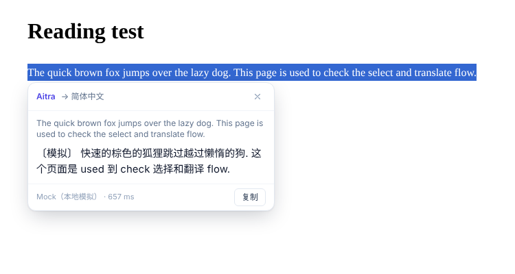
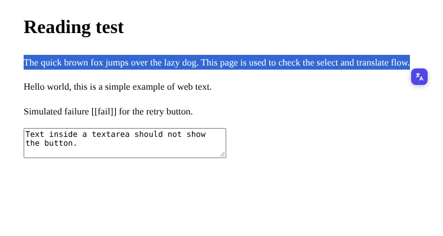
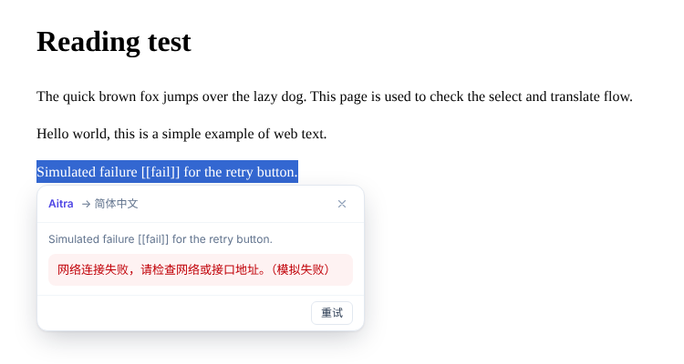
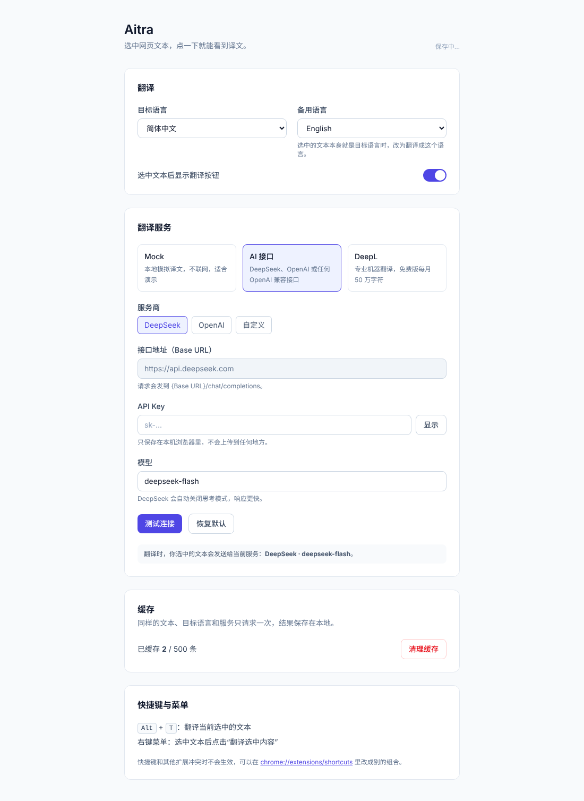

# Aitra

Aitra 是一个 Chrome / Edge 划词翻译扩展。在网页上选中一段文字，旁边会出现一个小按钮，点一下就在选区附近弹出原文和译文。也可以按 `Alt+T`，或者用右键菜单里的“翻译选中内容”。它不会改动页面本身的内容和排版。

翻译服务可以用 DeepSeek、OpenAI 或其他 OpenAI 兼容接口，也可以用 DeepL。没有 API Key 时默认用 Mock 模式，在本地生成模拟译文，整个流程照样能演示。



## 为什么做这个

平时读英文文档和文章，经常只是某一句看不太懂，为这一句去开翻译网站太麻烦，整页翻译又会把排版打乱。我想要的是：选中就能翻，翻完就消失，用自己的 API Key，选中的文本只发给我自己选的服务。顺便也想把 Manifest V3 扩展的几个难点完整地走一遍：Shadow DOM 样式隔离、Service Worker 里的流式请求、权限尽量少申请。

## 功能

- 选中 1–1000 个字符后，在选区末尾显示浮动按钮。输入框、文本域和可编辑区域里不显示。
- 翻译卡片显示原文、译文、复制按钮和关闭按钮。按 `Esc` 或点卡片外面会关闭；页面滚动时卡片跟着选区走，选区滚出屏幕就自动关闭。
- AI 接口支持流式输出，译文边生成边显示。
- 快捷键 `Alt+T`（可以在 `chrome://extensions/shortcuts` 里改）。
- 右键菜单“翻译选中内容”。
- 选中的文本本身就是目标语言时（比如目标语言是中文，选的也是中文），会自动改为翻译成备用语言，默认是英文。
- 本地缓存：按「文本 + 目标语言 + 服务/模型 + 术语表版本」的 SHA-256 作为键，最多保留 500 条，超出后删除最早的记录。设置页能看到条数，也能一键清理。
- 出错时给出可读的提示，比如没填 Key、Key 无效、限流、额度用完、超时、网络失败等，并保留原文和重试按钮。

| 浮动按钮 | 出错时 |
| --- | --- |
|  |  |

<!-- TODO: 录一段操作 GIF 放在 docs/demo.gif -->

## 本地运行

需要 Node.js 20 或更高版本。

```bash
git clone <your-repo-url> aitra
cd aitra
npm install
npm run build
```

然后在 Chrome 里加载：

1. 打开 `chrome://extensions`
2. 打开右上角的“开发者模式”
3. 点“加载已解压的扩展程序”，选择项目里的 `.output/chrome-mv3` 目录
4. 打开任意普通网页（扩展安装前就开着的页面需要刷新一次），选中一段英文试试

Edge 的步骤一样，地址是 `edge://extensions`。

开发时可以用 `npm run dev`，WXT 会打开一个已加载扩展的浏览器，改代码后自动重新加载。

其他命令：

```bash
npm test          # 单元测试（Vitest）
npm run compile   # 类型检查
npm run zip       # 打包成可上传商店的 zip，输出在 .output/
```

## 配置翻译服务

点工具栏上的扩展图标，再点“设置”，就能打开设置页。所有改动会自动保存，立即生效。



### DeepSeek（推荐先用这个测试）

1. 在 DeepSeek 开放平台创建 API Key
2. 设置页选“AI 接口”，服务商选“DeepSeek”
3. 填入 API Key，模型默认是 `deepseek-flash`
4. 点“测试连接”

DeepSeek 的模型默认开启思考模式，会先生成一段推理再给出答案。翻译用不上这一步，所以请求里会带上 `thinking: { type: "disabled" }`，响应会快很多。

### OpenAI

服务商选“OpenAI”，填 Key。模型默认是 `gpt-4.1-mini`，可以改成你账号里能用的任何模型。

### 其他 OpenAI 兼容接口

服务商选“自定义”，填 Base URL（请求会发到 `{Base URL}/chat/completions`）、API Key 和模型名。因为扩展默认只能访问内置的几个域名，第一次使用自定义地址时，设置页会请求访问这个域名的权限，只申请这一个域名。

### DeepL

设置页选“DeepL”，填 Key。免费版的 Key 以 `:fx` 结尾，会自动使用 `api-free.deepl.com`；付费版使用 `api.deepl.com`。DeepL 不支持流式输出，译文会一次性显示。

### Mock

默认选项。不联网，用一个很小的词表把英文“翻”成看起来像中文的文字，只用来演示流程，不是真的翻译。选中的文本里带 `[[fail]]` 时会模拟一次网络失败，可以用来看错误提示和重试按钮。

## 权限说明

| 权限 | 用途 |
| --- | --- |
| `content_scripts` 匹配 `<all_urls>` | 在任意网页上监听选区、显示按钮和卡片。这也是安装时提示“读取和更改所有网站上的数据”的原因 |
| `storage` | 保存设置、API Key 和翻译缓存（`chrome.storage.local`） |
| `contextMenus` | 右键菜单“翻译选中内容” |
| `host_permissions`：`api.deepseek.com`、`api.openai.com`、`api.deepl.com`、`api-free.deepl.com` | 后台调用这几个翻译接口 |
| `optional_host_permissions`：`https://*/*`、`http://*/*` | 只在你配置自定义接口并点击授权时，申请那一个域名 |
| `commands` | `Alt+T` 快捷键，不需要额外权限 |

没有申请 `tabs`、`history`、`cookies`、`scripting` 等权限。右键菜单和快捷键的回调里本身就带有当前标签页的 ID，所以不需要 `tabs`。

## 隐私

- 默认的 Mock 模式不发出任何网络请求。
- 切换到其他服务后，**你选中的文本会发送给当前选择的翻译服务**（DeepSeek、OpenAI、DeepL 或你填的自定义接口）。设置页和卡片底部都会显示当前用的是哪个服务。这些服务怎么处理数据，以它们各自的隐私政策为准。
- API Key 只保存在本机浏览器的 `chrome.storage.local` 里，不会同步，也不会发给除对应服务以外的任何地方。
- 扩展不收集使用数据，没有统计和埋点。出错时控制台只记录错误类型和文本长度，不记录选中的内容和 Key。服务方返回的错误信息里如果出现类似 Key 的字符串，会先打码再显示。
- 翻译结果缓存在本地，可以在设置页清理。

更完整的说明见 [PRIVACY.md](PRIVACY.md)。

## 项目结构

```
entrypoints/
  background.ts        消息路由、右键菜单、快捷键
  content.tsx          挂载 Shadow DOM
  content/             浮动按钮和翻译卡片（React）
  options/             设置页
  popup/               工具栏弹窗
lib/
  providers/           Mock / OpenAI 兼容 / DeepL，统一实现 translate(text, options)
  translation/         缓存 → 调用 → 超时 → 重试的流程
  storage/             设置（Zod 校验）和缓存
  messaging/           content 与 background 之间的消息类型
  dom/                 选区读取、定位、复制
tests/                 Vitest 单元测试
```

几个设计上的取舍：

- **content script 不直接请求翻译接口。** 所有请求都在 background 里发，Key 不会进入网页所在的进程，CORS 也由 host_permissions 统一处理。
- **翻译走 `runtime.connect` 长连接，而不是 `sendMessage`。** 这样能把流式输出一段一段推给页面；卡片关闭时断开连接，后台随之取消请求。
- **外部数据都先解析再用。** 存储里的设置、接口返回的 JSON、SSE 的每一块、页面和后台之间的消息，都用 Zod 校验，不合法的直接丢弃或报错。
- **译文只以文本节点的形式插入。** React 渲染文本时不会解析 HTML，不存在把接口返回内容当作 HTML 执行的风险。
- **超时分两段。** 12 秒内没收到任何响应就算超时；开始输出后，整次请求最多 30 秒。只有限流、超时、网络错误和 5xx 会自动重试 1 次，而且只在还没有显示任何译文时重试。

## 已知问题

- Chrome 不允许扩展在 `chrome://` 页面、Chrome 应用商店和内置 PDF 查看器里运行，这些页面上用不了。
- 安装或更新扩展之前就打开的标签页，需要刷新后才能使用。
- 不支持跨域 iframe 里的划词。在 iframe 里用右键菜单时，会拿菜单提供的选中文本去翻译，卡片显示在页面右上角。
- 输入框、文本域和可编辑区域里的选择会被忽略，这是有意的；在这些地方按 `Alt+T` 也不会触发。
- `Alt+T` 如果和别的扩展或系统快捷键冲突，Chrome 不会注册它，需要到 `chrome://extensions/shortcuts` 手动改。浏览器级快捷键会优先于网页自己的快捷键。
- “选中内容已经是目标语言”的判断目前只能识别中文、日文、韩文和俄文。拉丁字母的语言（英文、法文等）分辨不出来，所以目标语言设成英文时选英文，会得到一段几乎一样的“译文”。
- 流式输出到一半出错时不会自动重试（否则已经显示的文字会重复），需要手动点“重试”。
- API Key 以明文存放在浏览器的本地存储里，能访问你浏览器配置目录的程序可以读到。
- 自定义接口允许 `http://` 地址，但这样 Key 会以明文传输，建议只在本机或内网使用。

## 后续计划

- 术语表（缓存键里已经预留了术语表版本）
- 生词本和单词发音
- 拉丁字母语言的源语言识别
- 可选的 Ollama 本地模型
- 卡片的深色模式
- Playwright 端到端测试并接入 CI
